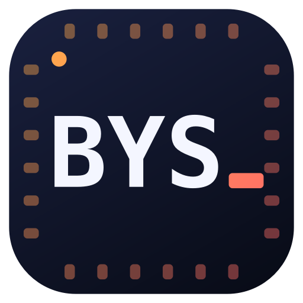

# BYSTerm — İndir / Download

Seri port, TCP, UDP, seri port dinleme, sanal port ve ağ araçları tek uygulamada.
**Windows, macOS, Linux, NVIDIA Jetson ve Android** için. Bu depo yalnızca sürümleri barındırır.

Serial port, TCP, UDP, serial port monitoring, virtual ports and network tools in one app.
For **Windows, macOS, Linux, NVIDIA Jetson and Android**. This repository only hosts the releases.

## [⬇ En son sürüm / Latest release](../../releases/latest)

| Sistem / System | Dosya / File |
|---|---|
| Windows 10/11 — kurulum (önerilen) / installer (recommended) | `BYSTerm-Setup-windows-x64.exe` |
| Windows 10/11 — taşınabilir / portable | `BYSTerm-windows-x64.exe` |
| macOS Apple Silicon (M1–M4) | `BYSTerm-macos-arm64.zip` |
| macOS Intel | `BYSTerm-macos-x64.zip` |
| Linux PC (Ubuntu 18.04+) | `BYSTerm-linux-x64.tar.gz` |
| NVIDIA Jetson (JetPack 4/5/6), Raspberry Pi 64-bit | `BYSTerm-linux-arm64.tar.gz` |
| Android 9+ telefon / tablet (phone / tablet) | `BYSTerm-android-arm64.apk` |
| Android emülatör / Chromebook (x86_64) | `BYSTerm-android-x64.apk` |

- **Windows:** Kurulum programını çalıştırın. Seri İzleme için gereken USBPcap sürücüsü otomatik kurulur;
  ardından Windows bir kez yeniden başlatılır. İlk açılışta "Windows bilgisayarınızı korudu" çıkarsa
  *Ek bilgi → Yine de çalıştır*. / Run the installer; the USBPcap driver needed by Serial Monitor is
  installed automatically, then Windows restarts once.
- **macOS:** Zip'i açın, `BYSTerm.app`'i Uygulamalar'a sürükleyin, ilk açılışta *sağ tık → Aç*.
- **Linux / Jetson:** `tar xzf BYSTerm-linux-*.tar.gz && cd BYSTerm && ./BYSTerm` (menüye eklemek için `./install.sh`).
- **Android:** APK'yı telefonda açıp kurun (gerekirse "bilinmeyen uygulamaları yükle" iznini verin). USB-seri
  çeviriciyi USB-OTG kabloyla takın; ilk bağlantıda USB izni sorulur. Seri İzleme, Sanal Port ve Ağ Ayarları
  Android'de yoktur. / Open the APK on the phone to install it; plug the USB-serial adapter in with a USB-OTG
  cable and allow USB access when asked.

Uygulama yeni sürümleri buradan kendisi bulur (Ayarlar → Güncellemeleri kontrol et).
The app checks this page for new versions itself (Settings → Check for updates).

---
Geliştirici / Developer: **BYS**

Windows kurulumu, Seri İzleme için USBPcap sürücüsünü içerir (GPL-2.0, kaynak / source:
[github.com/desowin/usbpcap](https://github.com/desowin/usbpcap)).

Android sürümü usb-serial-for-android kütüphanesini kullanır (MIT, kaynak / source:
[github.com/mik3y/usb-serial-for-android](https://github.com/mik3y/usb-serial-for-android)).
